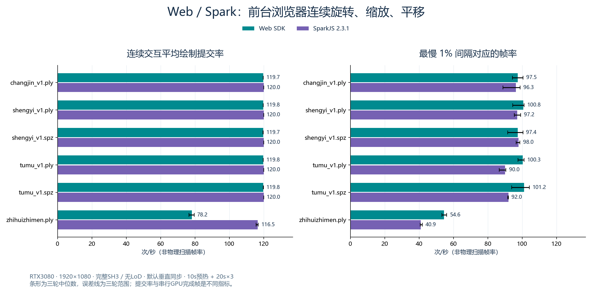

# Web / Spark 连续交互性能补充报告

2026-10-04。当前源码下的前台 Edge 浏览器实测；本轮不以画质差异为验收条件。

## 结论

**当前不能说Web实际浏览帧率远超Spark。** 17万至125万点的五组PLY/SPZ，两端都接近120次提交/秒；391万点模型，Web三轮中位78.2，Spark116.5，Spark连续提交率约高49%。Web在提交间隔指标中的1% low较高：该大模型约54.6，对照Spark40.9；但独立浏览器Present轨迹的p95间隔由Spark更短，不能仅依据提交1% low声称Web显示更流畅。

此前等待每个相机的排序和GPU完成，刻意串行化；正常浏览时Spark允许旧排序的绘制与后台更新重叠，而Web SDK使用每帧在途门控并为提交相机执行投影/排序。当前瓶颈分析应优先消融SDK调度和排序更新策略，不能只根据独立GPU阶段断言浏览更快。

## 测试条件

RTX 3080 10GiB、32GB RAM、Windows；Edge 154.0.4258.53，1920×1080、DPR1、完整SH3、相同模型SHA、关闭LoD。浏览器有可见窗口，未添加解除帧率/垂直同步限制的参数。每组 10 秒预热，20 秒采样 × 3 轮。模型之间交替先测的引擎，单GPU顺序执行。

旋转、缩放和平移按墙钟时间重复，轨道角幅度±0.4rad，近景缩放到0.4倍距离，平移幅度0.15倍距离。通过SDK相机接口重放连续操作，不测鼠标硬件、OS事件派发或人的操作差异。两者同时间路径，但不同帧率下采样点数量不同。

**Web 使用 SDK resume/tick 的正常调度与单帧在途门控；Spark 使用 renderer.render 和默认 autoUpdate 的异步排序。连续采样期间不等待本帧排序，不调用 gl.finish，不等待 GPU timer 或 fence。SDK 自身的队列完成门控保留。** Spark preserveDrawingBuffer 关闭，基准额外WebGL timer关闭；Web自带异步timestamp仍保留。

此前串行完成协议等待当前相机排序和GPU完成，不能代替本轮浏览性能；此次也没有绕过Web SDK直接调用renderer作为正式结果。

## 连续绘制提交与尾部

表中每项取三轮统计值的中位数。提交FPS为真实renderer调用数/采样墙钟，rAF输入次数另保留在JSON中。1% low按最慢1%提交间隔的平均值倒数计算；它不是1000/p99。

| 模型 | 点数 | Web 提交FPS | Spark 提交FPS | Web p95间隔ms | Spark p95间隔ms | Web 1% low | Spark 1% low |
| --- | ---: | ---: | ---: | ---: | ---: | ---: | ---: |
| changjin_v1.ply | 170,799 | 119.7 | 120.0 | 8.50 | 8.50 | 97.5 | 96.3 |
| shengyi_v1.ply | 804,758 | 119.8 | 120.0 | 8.50 | 8.80 | 100.8 | 97.2 |
| spz/shengyi_v1.spz | 804,758 | 119.7 | 120.0 | 8.50 | 9.40 | 97.4 | 98.0 |
| tumu_v1.ply | 1,248,730 | 119.8 | 120.0 | 8.50 | 9.80 | 100.3 | 90.0 |
| spz/tumu_v1.spz | 1,248,730 | 119.8 | 120.0 | 8.50 | 10.00 | 101.2 | 92.0 |
| zhihuizhimen.ply | 3,914,609 | 78.2 | 116.5 | 16.80 | 18.90 | 54.6 | 40.9 |

## 相机提交、主线程和长任务

cameraToSubmissionMs仅为采样相机更新到绘制提交的时间。Web在SDK自己的下一rAF消费相机，Spark在本轮rAF立即提交，因此此值含宿主调度差异，不能写成input-to-photon。Web在提交中投影/排序当前相机；Spark允许使用已有排序继续呈现，同时后台更新排序。这解释了为何正常浏览和串行完成的结果可以差别很大。

| 模型 | 引擎 | 相机→提交p50 ms | 提交CPU p50 ms | >33.3ms间隔占比 | 每轮长任务数量 |
| --- | --- | ---: | ---: | ---: | --- |
| changjin_v1.ply | Web | 8.30 | 0.10 | 0.00% | 0 / 0 / 0 |
| changjin_v1.ply | Spark | 0.00 | 0.10 | 0.00% | 0 / 0 / 0 |
| shengyi_v1.ply | Spark | 0.00 | 0.10 | 0.00% | 0 / 0 / 0 |
| shengyi_v1.ply | Web | 8.30 | 0.10 | 0.00% | 0 / 0 / 0 |
| spz/shengyi_v1.spz | Web | 8.30 | 0.10 | 0.00% | 0 / 0 / 0 |
| spz/shengyi_v1.spz | Spark | 0.00 | 0.20 | 0.00% | 0 / 0 / 0 |
| tumu_v1.ply | Spark | 0.00 | 0.20 | 0.00% | 0 / 0 / 0 |
| tumu_v1.ply | Web | 8.30 | 0.10 | 0.00% | 0 / 0 / 0 |
| spz/tumu_v1.spz | Web | 8.30 | 0.10 | 0.00% | 0 / 0 / 0 |
| spz/tumu_v1.spz | Spark | 0.00 | 0.20 | 0.00% | 0 / 0 / 0 |
| zhihuizhimen.ply | Web | 8.40 | 0.10 | 0.00% | 0 / 0 / 0 |
| zhihuizhimen.ply | Spark | 0.00 | 0.20 | 0.00% | 0 / 0 / 0 |

## 按操作阶段的提交间隔

每轮包含6秒旋转、6秒缩放、6秒平移及剩余旋转；统计仅分组提交样本，不重新定义为独立场景实验。以下为三轮阶段p95间隔的中位数。

| 模型 | 引擎 | 旋转 p95 ms | 缩放 p95 ms | 平移 p95 ms |
| --- | --- | ---: | ---: | ---: |
| changjin_v1.ply | Web | 8.50 | 8.50 | 8.50 |
| changjin_v1.ply | Spark | 8.50 | 8.50 | 8.50 |
| shengyi_v1.ply | Spark | 8.90 | 8.60 | 8.90 |
| shengyi_v1.ply | Web | 8.50 | 8.50 | 8.50 |
| spz/shengyi_v1.spz | Web | 8.50 | 8.40 | 8.50 |
| spz/shengyi_v1.spz | Spark | 9.30 | 9.50 | 9.40 |
| tumu_v1.ply | Spark | 9.90 | 9.80 | 9.90 |
| tumu_v1.ply | Web | 8.50 | 8.50 | 8.50 |
| spz/tumu_v1.spz | Web | 8.50 | 8.50 | 8.50 |
| spz/tumu_v1.spz | Spark | 10.00 | 10.00 | 10.00 |
| zhihuizhimen.ply | Web | 16.80 | 16.80 | 16.80 |
| zhihuizhimen.ply | Spark | 18.90 | 18.90 | 18.90 |

## 独立浏览器呈现轨迹

在391万点模型另做5秒预热+20秒单轮trace，使用NavigationStart单调时钟定位采样窗口。该轮有额外采集开销，不进入上述正式三轮统计。

| 引擎 | 提交率 | 浏览器DrawFrame率 | DComp Present调用率 | Present间隔p95 ms | Present 1% low |
| --- | ---: | ---: | ---: | ---: | ---: |
| Web | 81.9 | 81.9 | 81.9 | 16.98 | 56.1 |
| Spark | 115.7 | 115.7 | 115.7 | 8.52 | 59.7 |

提交与浏览器DrawFrame/Present的频率接近，独立轨迹同样支持当前大模型Spark更高的连续呈现调用率。Spark的Present间隔p95约8.52ms，Web约16.98ms；浏览器/GPU队列能平滑部分JS提交抖动，因此提交间隔的尾部排序与Present间隔可能不同。这里是浏览器/DirectComposition事件，不是通过光电传感器测得的物理屏幕新帧或端到端鼠标延迟。[轨迹摘要](trace-summary.json)

## 证据、限制和复现

主结果经补测后全组完成、模型点数/SH/SHA通过校验，采样中页面始终visible，pageerror和console.error为空。首次391万点Web加载曾报backing read stalled；保留attempt-1-results.json，随后用同源码完整补测的双引擎三轮配对替换该模型，未按结果挑选单轮。独立trace首次也遇到相同加载错误，因此这是实际观察到的间歇性加载可靠性问题，原因尚未隔离，不能宣称它已修复。原始结果保留Web的Windows powerPreference提示与Spark的驱动shader signed/unsigned编译警告。加载数值不是本轮目标，不用这一轮单次加载更新原报告的首载结论。

**提交FPS不是物理显示器扫描FPS。** 浏览器合成器可丢弃提交、重复旧内容或受刷新率封顶。另行短trace观察合成/Present事件；trace有额外开销，不混入正式三轮表，也不等于光电测得的显示延迟。所有结果只覆盖本机、该路径与六组模型，不保证所有平台或最大2248万点表现。

Spark排序年龄仅为旁路观察Worker sortSplats32 RPC完成并匹配历史相机位置，不能等同物理呈现时排序年龄；Web值0表示该提交使用当前相机投影/排序，不表示GPU零时延。该诊断不作为本轮帧率胜负标准。

[完整JSON](../../../../ForWeb/docs/verification/evidence/interactive-2026-10-04/results.json)；同目录逐模型JSON保留所有提交/输入间隔、长任务、visibility和采样窗口，PNG为计时之外的Canvas验证。

在ForWeb目录、现有模型dev server运行时执行 `node tools/interactive-benchmark.mjs`。默认10s+20s×3，可用GS_BENCH_WARMUP_MS/GS_BENCH_SAMPLE_MS/GS_BENCH_RUNS改变预算；GS_BENCH_TRACE=1启用独立trace，必须使用不同GS_BENCH_OUTPUT目录。默认有可见Edge窗口，运行期间保持前台并避免其它GPU任务。

报告摘要可从仓库根运行 `python docs/reports/native3dgs-2026-10-04/interactive_summary.py` 重建。引擎源码未修改，仅扩展基准入口与测试驱动。基准入口通过独立严格TypeScript编译，SDK typecheck、36个单元测试、18个契约测试和git diff --check通过；这些不表示间歇性OPFS问题已关闭。
