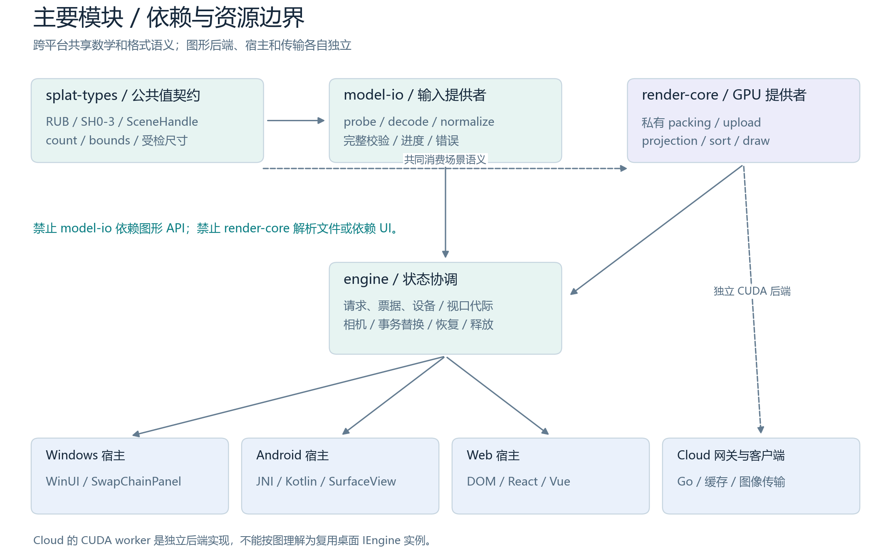
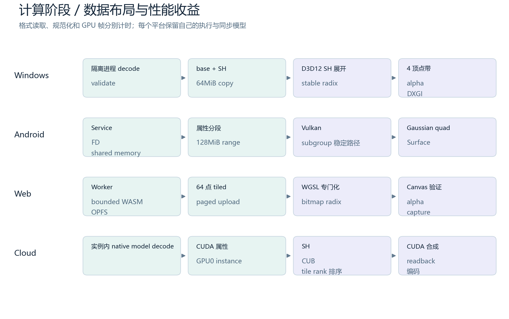
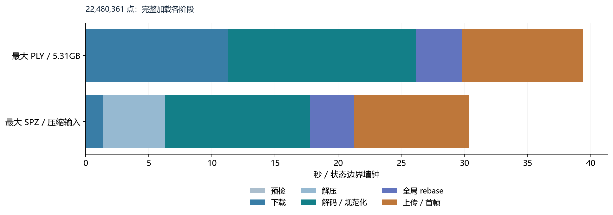

# 原生3DGS引擎架构与性能报告

2026-10-04。源码参考 `d088902bcc464ef7bea1fca857f2b7cd3f10836c`；协议和证据范围见正文。

## 原生 3DGS 引擎架构与性能报告

Windows / Android / Web / Cloud  |  技术预览与实测证据  |  2026-10-04

本报告解释四个平台的实际引擎结构、核心技术栈、资源边界和已验证的性能优化，并整理 Windows / Web 与 SparkJS 的模型加载和计算阶段对照。架构图按平台独立绘制；性能表由原始 JSON 与基准日志生成，完整模型、格式、点数与 SHA 可追溯。

| 平台 | 计算位置 / 图形接口 | 交付与当前状态 |
| --- | --- | --- |
| Windows | 本地 CPU + D3D12 / HLSL | C++20 SDK + WinUI 3；大场景与 GPU 阶段已实测 |
| Android | 本地 Service + Vulkan / SPIR-V | NDK C ABI + Kotlin AAR；Adreno 735/750 技术预览 |
| Web | Worker / WASM + WebGPU / WGSL | ESM SDK 0.2.2-preview.1；DOM / React / Vue 可选入口 |
| Cloud | 服务端 C++ / CUDA / CUB | Go / SQLite / 缓存 + WinUI 图像客户端；API v3 |

### 本报告的新增测量

Windows：7 个模型，60 帧预热 + 120 帧采样，每模型 3 个独立进程；保留 SH3、stride=1。Web / Spark：6 个同文件模型、12 组结果，每组 30 帧预热 + 120 个相机姿态 × 3 轮；另做 18 个固定视角的图像比较。模型范围从 170,799 到 22,480,361 点；Web 全量加载附录覆盖全部 38 个 PLY/SPZ。

> 结论边界：Web 首次加载在本次六组中均慢于 Spark；本帧完成墙钟时间较小，但包含不同同步与 timer 观察开销，不能写成物理 FPS 胜出。Windows GPU 阶段与 Spark WebGL query 范围不同。391 万点新样本的前景 SSIM 最低 0.9865，不能声明全套等画质验收通过。

源码参考：d088902bcc464ef7bea1fca857f2b7cd3f10836c。Windows 使用已有 Release 二进制，本报告记录其 SHA 和修改时间，不声称本次重新构建了原生引擎。Web 运行当前源码；已有 38 模型/最大模型数据沿用 2026-10-04 发布验证，未冒充新增重复测量。

## 阅读索引与结论导航

先看架构，再按计时范围阅读性能；完整数据与复现入口位于附录

| 部分 | 内容 | 主要证据 |
| --- | --- | --- |
| 01 / 口径与边界 | 共享模块、线程与所有权；公平比较条件 | S01/S02/S05/S12/S19 |
| 02 / 四个平台 | 各平台独立架构图、目录映射、技术栈、性能细节 | S01/S06/S09/S12 |
| 03 / Windows | 7 模型加载/上传/GPU阶段；与 Spark 诊断并列 | S03/S04/S05/S16 |
| 04 / Web | 六模型首帧、完成帧、阶段、尾部；18 视角质量 | S16/S17/S19 |
| 05 / 大模型与优化 | 2248 万点完整加载、GPU瓶颈、受控消融 | S13/S14/S15/S21 |
| 06 / 验收与方向 | 测试覆盖、已知薄弱点、改进优先级 | S07/S08/S11/S13/S22 |
| 附录 / 全数据 | 38 模型阶段表、文件SHA、复现与证据索引 | S04/S14/S16/S20 |

### 五项可直接使用的判断

1. 四端遵循相同的格式/场景/渲染/引擎分层，但图形后端并非同一套 API：D3D12、Vulkan、WebGPU、CUDA 分别负责本地或服务端 GPU。2. 当前 Cloud 把图像传回客户端；Web 云图像客户端尚未实现。3. Windows 与 Web 最大模型均保留完整 SH3 点集合，本机有实际容量证据。

4. Windows 的解码/上传路径比浏览器 OPFS 链路更短，但当前 Windows 表不包含首帧、设备初始化与 Present；不能直接用其阶段和对比 Spark 的完整首帧。5. Spark 的 Rust/WASM、压缩数据与 Worker 排序具有值得借鉴的流式和局部性设计；语言标签本身不能解释端到端差异。

## 01 / 性能指标与可比性

相同模型名、相同分辨率，并不自动意味着同一成本或同一画质

| 指标 | 起止边界 | 允许 / 不允许的解释 |
| --- | --- | --- |
| Windows load_ms | make_model_loader()->load 的完整等待 | 包含进程/读取/解压/规范化/验证；不是单独解码 kernel |
| Windows upload_ms | UploadTransaction 启动至 ready | 包含 packing/copy/fence；不含设备初始化和首帧 |
| Windows GPU stages | D3D12 四时间戳，强制全量 project/sort/draw | 60+120 ×3，固定 fit 相机、无 Present；不是屏幕帧率 |
| Web firstFrameMs | open 至首帧 GPU完成 / Spark 首排序+draw+finish | 同一 Web 入口和模型；每组仅一次加载，非三轮加载统计 |
| Web completedMs | 每个相机姿态更新至本帧完成与 timer 可用 | 含 Worker/update/readPause/IPC/同步等待；不测扫描显示 |
| Web GPU stages | WebGPU projection / radix / draw timestamps | 同一个 gpuFrameId；约 65.5 微秒量化 |
| Spark gpuMs / updateMs | 同步 WebGL query / spark.update 墙钟 | 前者不含异步Worker排序；后者不是纯排序 kernel |
| 38 模型 stage wall | Loading 各 stage 状态切换 | CPU、WASM拷贝、OPFS I/O均可在stage中；不能当纯CPU时间 |

> 统计口径：Windows 表为三轮每轮样本中位数再取中位数；Web 沿用 runner 的 p50/p95 定义，再报告三轮中位或范围。p50/p95 各阶段分别统计，阶段 p50 之和不一定等于总帧 p50。磁盘/OS/浏览器缓存没有清空，所有加载结果都不是“冷缓存性能”声明。

测试环境：Windows x64、32GB RAM、NVIDIA RTX3080 10GiB、驱动616.92；Web 使用 Edge154.0.4258.53、1920×1080、DPR1、SH3、完整点集合、径向排序、无LoD。Spark2.3.1 / Three0.180.0，extSplats / accumExtSplats；固定参数包括 FOV60°、3σ、minAlpha1/255、preBlur0.3、maxRadius4096。Windows固定相机与Web运动姿态不同，因此只作诊断并列。[S04/S05/S16/S19]

## 02 / 模块依赖与资源边界

架构共性：可替换宿主、不可变场景、独立解码与渲染提供者

图1：模块依赖图。Cloud 复用数学/格式语义，CUDA worker 和网关是独立实现，不是桌面 IEngine 的网络包装。
[独立矢量图](figures/module-boundaries.svg)

## 03 / Windows 引擎架构

已实现路径；C++20 / Direct3D12 / HLSL / WinUI3

![图2：Windows 平台独立架构。解码隔离进程发布只读场景，renderer 独占 device/queue；宿主按 generation 绑定交换链。[S01/S02]](figures/architecture-windows.png)

图2：Windows 平台独立架构。解码隔离进程发布只读场景，renderer 独占 device/queue；宿主按 generation 绑定交换链。[S01/S02]
[独立矢量图](figures/architecture-windows.svg)

## Windows / 主要模块、线程与性能机制

原生 SDK 与 WinUI 宿主解耦；容量优化和帧时间优化分别记录

| 模块 / 源码 | 职责与数据结构 | 关键机制 |
| --- | --- | --- |
| include/splat-types + src/model-io | 只读 SceneHandle；PLY/SPZ探测、解码、RUB规范化、SH校验 | Job Object 隔离子进程；取消/超时/峰值；PLY约4MiB读取 |
| src/render-core/scene | 属性/SH私有缓冲、分块上传事务 | 64MiB copy页；真实DXGI local/non-local/UMA预算；新旧峰值 |
| src/render-core/passes | 投影+SH、稳定 radix、Gaussian quad透明绘制 | FidelityFX Parallel Sort；4-bit ×8 pass；上限16000组 |
| src/engine + include/native3dgs | 协调线程、double世界相机、相对float32 GPU、请求/票据/代际 | 首帧Present后事务激活；事件队列与快照；设备解绑确认 |
| GUI/ | WinUI3 / Windows App SDK1.8 / SwapChainPanel | 不解析模型；surface_generation；输入与SDK状态消费 |

### 已保留的性能改进

上传页4→64MiB使大模型上传从约20.3秒降至约1.5秒。排序工作组上限800→16000使2248万点排序约10.1→7.8ms。SH动态循环固定展开保持原累加顺序，大模型投影约15.1→10.3ms。6次顶点调用改为4顶点三角带，绘制约16.4→15.34ms；当时force完整GPU帧约33.4-33.8ms。单轮结果与本次三轮数值不能视为同一个实验。[S03]

ProjectedEllipse 48→40字节减少最大场景约180MB投影缓冲，是容量收益，未证明独立帧时间收益。128MiB copy页、四元数矩阵展开、行列式代数改写和3顶点覆盖三角形均未达到可靠或全面收益而撤回。静止相机复用排序，cached路径只代表绘制，不与force全排序帧混合。

> Windows 允许显式质量缓解：先降GPU SH，再按2/4/8/16索引间隔显示；必须报告实际点数/SH。当前测量使用SH3、stride1，所有降质数据排除。Web 当前策略则在资源不足时明确拒绝，不自动抽点或降SH。

## 04 / Android 引擎架构

已实现路径；Kotlin / JNI / C ABI / Vulkan1.1 / GLSL-SPIR-V

![图3：Android 平台独立架构。Binder只传FD/状态，完整模型驻共享映射与GPU，UI不承载逐点大数组。[S06/S07]](figures/architecture-android.png)

图3：Android 平台独立架构。Binder只传FD/状态，完整模型驻共享映射与GPU，UI不承载逐点大数组。[S06/S07]
[独立矢量图](figures/architecture-android.svg)

## Android / 模块与移动设备边界

不同设备的 storage range、热状态和 subgroup 能力必须实机验证

| 模块 | 职责与交付 | 实现细节与限制 |
| --- | --- | --- |
| model-io Service | 复用 native PLY/SPZ数学；只读FD和ASharedMemory | 非seek有界临时文件；Binder死亡/超时；完整布局与内容复核 |
| render-core Vulkan | SceneRenderer / stable GPU sort / Gaussian+SH | storage range分段；subgroup自检+后备；fence后读timestamp |
| engine | 协调、相机、待命/活动scene、Surface代际 | 提交成功后激活；旧generation不能复活；零Surface暂停 |
| android-bridge / SDK | C ABI、JNI、Kotlin AAR、Native3dgsEngine | SurfaceView / ANativeWindow引用；宿主协程关闭，UI不长等fence |
| GUI / 构建工具 | Kotlin2.0.21 / JDK21 / NDK27.2 / SDK35 | API29+、arm64-v8a技术预览；非WebView后端 |

### 真机性能支持什么结论

Adreno750平板：1,888,950点SPZ，30秒预热+60秒采样。基线三轮Present-call中位值的中位数78.12ms，最终subgroup路径56.55ms；GPU排序均值三轮中位34.98→17.84ms。仅最终第1轮全程thermal0，后两轮存在thermal3，不能称严格等热态性能验收。实测显示间隔50ms，未达到33.3ms/30FPS移动门槛。[S08]

Juyuan 2,670,017点 SH3：设备maxStorageBufferRange=128MiB；属性拆成128MiB与约15.3MB两段，SPZ和PLY完整上传首帧成功。该实现最多两段；投影buffer仍把此设备上限限制为2,796,202点，且需足够compute storage descriptors。没有把安卓的大场景能力外推到Web的2248万点模型。

> 这些 Android 数据用于说明架构的实际动机，不是与 SparkJS 的同机比较。模拟器不能证明移动GPU速度；完整SSIM、热稳与跨驱动门槛仍未关闭。

## 05 / Web 引擎架构

实际交付版本0.2.2-preview.1；框架可选，核心API统一

![图4：Web 平台独立架构。解码Worker与主线程WebGPU分离；tiled backing分页进入同一全局稳定排序。[S12/S13]](figures/architecture-web.png)

图4：Web 平台独立架构。解码Worker与主线程WebGPU分离；tiled backing分页进入同一全局稳定排序。[S12/S13]
[独立矢量图](figures/architecture-web.svg)

## Web / WASM、OPFS 与 GPU 热路径

容量与取消可靠性优先；保留所有点、float32和SH0-3

| 模块 / 技术栈 | 结构与职责 | 性能 / 可维护性细节 |
| --- | --- | --- |
| src/splat-types + model-io | Result、预算、readonly scene；Worker + C++20/WASM | Emscripten6.0.11；PLY/SPZ1-4；共享normalize语义 |
| native + streaming + backing | 批次decode/pack、gzip校验、OPFS持久backing | ≤65536点且输入≤4MiB；并读六列；CRC/长度；一次全局rebase |
| src/render-core | WGSL投影/SH、4-bit稳定radix、透明绘制 | 64点tiled float32；bitmap/popcount rank；2D dispatch/分段prefix |
| src/engine | load latest-wins；相机；离屏及Canvas候选验证 | 旧场景失败回滚；deadline；可移除lost订阅；GPU预算统一 |
| src/web-adapters + react/vue | DOM生命周期；可选ESM子路径；订阅与host绑定 | React19.3、Vue3.5.43；StrictMode/条件host/SSR消费 |
| 构建 / 测试 / 包 | Node24.14、pnpm11.4、TS7.0.2、Vite8.3.2 | Vitest5 / Playwright1.63 / Biome2.5；锁定依赖/资产SHA |

大PLY与gzip SPZ v1-3用OPFS规避整场景WASM32峰值：下载到临时文件，SPZ解压列属性到磁盘，再小批次native规范化，写tiled backing，一次全局rebase，4MiB读取上传，累计32MiB等待fence。64点对齐末页padding仅影响存储；逻辑count、投影、排序、绘制均不包含padding。SPZ v4仍为有界内存路径。[S12/S13]

默认input/scene/GPU各8GiB、CPU512MiB、deadline600000ms；这些是策略预算，不是实际可用内存。最大GPU场景6,575,533,896B，backing5,305,370,624B。CPU residentBytes=0表示没有保留整份ArrayBuffer，不能解释为RSS/缓存为0。OPFS删除最多等5秒，失败仍释放GPU，在Stopped快照保留StorageCleanup诊断。

> GPU执行仍在主线程；渲染Worker、SIMD/pthreads、LoD、云客户端、WebXR、通用Three场景混合均未实现。现代技术栈版本不等于跨浏览器验证；当前实测仅Windows/Edge/NVIDIA。

## 06 / Cloud 引擎架构

实际API v3图像链路；服务端完整渲染，客户端只解码与显示

![图5：Cloud 平台独立架构。缓存hit可以不启动GPU实例；相同模型/视图共享缺失渲染。ProjectedSplats属于退役原型。[S09/S11]](figures/architecture-cloud.png)

图5：Cloud 平台独立架构。缓存hit可以不启动GPU实例；相同模型/视图共享缺失渲染。ProjectedSplats属于退役原型。[S09/S11]
[独立矢量图](figures/architecture-cloud.svg)

## Cloud / 实例、缓存和传输机制

单模型单进程、固定GPU；前台优先与缓存是主要交互性能策略

| 层 | 核心技术栈 / 模块 | 性能与资源机制 |
| --- | --- | --- |
| 原生渲染实例 | C++20 / CUDA13.0.88 / CUB；cuda_renderer.cu | 完整SH；径向/tile-rank排序；CUDA透明合成；无窗口/EGL |
| 服务网关 | Go1.27.1 / net/http / single-flight | 同视图缺失合并；每模型固定进程/GPU；默认最多4实例 |
| 元数据和图片缓存 | SQLite3.37.2 WAL NORMAL；磁盘原子rename | 24h TTL；10GiB/100000项LRU；模型/renderer hash；CRC/SHA |
| 图像协议 / 编码 | NGSREQ3 / NGSFRM02；Zstd1 / libjpeg-turbo | RGBA raw fallback；JPEG85-95；不用传原始splat数组 |
| WindowsClient | WinUI3 / 异步WinHTTP / D3D12显示 | 64MiB/256压缩包；前台+单后台；显示才解码；latest-wins |

离散相机为2°方位/极角网格及81个对数距离档；缓存key包含模型内容、renderer版本、位置、朝向、尺寸、质量。当前默认JPEG85，邻域预测每方向5/10/15档；租约120秒，10秒心跳，实例空闲宽限300秒。已有GPU0实例可复用，缓存hit不需要重载模型；网络命中、本地命中和GPU缺失渲染是不同成本。[S09/S11]

| 历史API v3缓存基准 / 267万点 /1080pRGBA | miss p50 / p95 | hit p50 / p95 |
| --- | --- | --- |
| Windows→映射入口，逐帧同步持久化 | 220.656 / 304.929ms | 106.261 / 135.139ms |
| 同相机，WAL NORMAL + 可重建缓存 | 74.182 / 84.527ms | 32.849 / 46.699ms |
| 服务器回环，同一优化链路 | 34.251 / 40.810ms | 2.440 / 2.808ms |

> 上表来自S10的20miss+20hit短基准，是读完HTTP响应的墙钟，不含WinUI解码/物理呈现，也不是本次0.2.2新测量。当前设备报告RTX4090/49140MiB，4卡只启GPU0；不把历史四卡吞吐写成当前架构扩展验收。公网TLS/RBAC、WAN长稳和全38模型云端覆盖仍未验收。

## 07 / 四端计算流水线

shared semantics 不代表相同存储、相同调度或相同统计范围

图6：主要模块内部的计算顺序与性能机制。File decode、GPU帧和云HTTP缓存命中必须分别解释。
[独立矢量图](figures/compute-pipeline.svg)

共同顺序：输入预检 → 解码/规范化 → GPU packing/upload → 相机相关投影/SH → 稳定排序 → 透明合成。Cloud额外包含tile任务、readback、编码/缓存/传输；Web额外包含WASM边界拷贝与OPFS多遍I/O。

## 08 / Windows：七模型加载与 GPU 阶段

本次新增诊断；单位ms；GPU列为三轮每轮p50再取中位数 [S04/S05]

| 模型 | 点数 | 读取/解码/验证 | GPU上传 | 投影+SH | 排序 | 绘制 | GPU总帧 |
| --- | --- | --- | --- | --- | --- | --- | --- |
| changjin_v1.ply | 170,799 | 91.6 | 30.9 | 0.094 | 0.138 | 0.206 | 0.439 |
| shengyi_v1.ply | 804,758 | 487.3 | 67.8 | 0.380 | 0.331 | 0.566 | 1.277 |
| shengyi_v1.spz | 804,758 | 711.6 | 64.8 | 0.380 | 0.328 | 0.561 | 1.270 |
| tumu_v1.ply | 1,248,730 | 694.9 | 104.4 | 0.578 | 0.465 | 0.864 | 1.906 |
| tumu_v1.spz | 1,248,730 | 1,075.5 | 115.5 | 0.579 | 0.464 | 0.864 | 1.907 |
| zhihuizhimen.ply | 3,914,609 | 1,953.6 | 275.7 | 1.779 | 1.263 | 2.671 | 5.720 |
| jiulonghu_v1.ply | 22,480,361 | 10,506.7 | 1,475.4 | 10.470 | 8.091 | 16.009 | 34.633 |

每个模型3个独立SceneBench进程，60预热+120采样，固定fit相机，force每帧重投影/重排，SH3/stride1/1920×1080。所有进程正常退出，计时样本120/轮；模型SHA和点数与manifest一致。Windows loader直接访问本地文件；未逐项分离纯文件读取、SPZ解压、属性规范化和验证。

同一规模的格式差异集中在CPU侧：shengyi PLY/SPZ约487/712ms；tumu PLY/SPZ约695/1076ms。GPU阶段相近，但两格式经SPZ量化后的源属性未必逐值相同。大PLY load约10.507秒、upload约1.475秒；GPU完整帧中位约34.633ms。阶段和约11.982秒不等于首个完成帧，因为还未包含device/pipeline/首帧设置。

> 二进制SHA-256：aa2da0d1708c50d433a297627c40b3e797953f0263574c4f271a6c4462610d04；修改时间UTC：2026-09-30T02:10:33.427041+00:00。本轮执行已有Release二进制，没有重新构建。日志和原始120帧数组已保留；依赖环境/时钟波动未做统计显著性检验。

## Windows：规模增长与 GPU 热点

固定相机强制排序路径；保持完整 SH3 和点数

![图7：三阶段p50中位的堆叠，仅用于瓶颈分布；不是阶段之和的整帧p50统计。[S04]](figures/windows-gpu-stages.png)

图7：三阶段p50中位的堆叠，仅用于瓶颈分布；不是阶段之和的整帧p50统计。[S04]
[独立矢量图](figures/windows-gpu-stages.svg)

最大模型约10.47ms投影、8.09ms排序、16.01ms绘制；绘制约占总帧46%，已不适合只围绕排序做优化。近景重叠、几何/像素成本、真实可见集合与压缩成本应分别消融。静止相机cached模式避开重投影与排序，不能替代用户运动时的force诊断。

## 09 / Windows、Web 与 Spark：加载对照

Windows列为两段已测墙钟的和；Web/Spark列均为各自首个完成帧

| 同一文件 | 输入MiB | 点数 | Windows decode+upload | Web首帧 | Spark首帧 |
| --- | --- | --- | --- | --- | --- |
| changjin_v1.ply | 38.44 | 170,799 | 125.6 | 686.2 | 610.0 |
| shengyi_v1.ply | 181.13 | 804,758 | 564.9 | 2,164.8 | 1,151.9 |
| shengyi_v1.spz | 17.10 | 804,758 | 776.4 | 1,769.7 | 915.6 |
| tumu_v1.ply | 281.05 | 1,248,730 | 794.4 | 3,331.7 | 1,771.6 |
| tumu_v1.spz | 23.28 | 1,248,730 | 1,191.0 | 2,651.9 | 1,252.3 |
| zhihuizhimen.ply | 881.05 | 3,914,609 | 2,251.4 | 9,734.3 | 4,876.7 |

新测六组中，Web/Spark首帧：changjin约686/610ms；shengyi PLY约2165/1152ms、SPZ约1770/916ms；tumu PLY约3332/1772ms、SPZ约2652/1252ms；391万点PLY约9734/4877ms。Web首次加载约为Spark的1.12-2.12倍，当前加载薄弱点跨两种格式存在。首载每组仅一次，不能把比值当长期统计结论。

Windows decode+upload明显更短，但测量起止不等价：它不含GPU设备/管线创建、首帧/Present/WinUI合成；Spark包含URL加载、Rust/WASM初始化、解码/pack、上传、首排序和同步绘制。Windows与Spark之间不计算“整体快多少倍”。同一文件SHA可以核验输入相同，却不能消除进程、缓存、相机和同步机制差异。[S04/S05/S16/S19]

> 在Web/Spark首帧列使用loaded.firstFrameMs，没有使用loaded.ms；后者Spark额外含60次draw/next稳定过程，误用会系统性放大Spark加载时间。最大2248万点没有Spark同协议数据，报告不填估计值。

## Windows / Spark：同模型渲染诊断并列

单位ms；三轮p50的中位值；相机与GPU query范围不同 [S04/S05/S16/S19]

| 同一文件 | Windows投影 | Windows排序 | Windows绘制 | Windows完整GPU | Spark同步GPU | Spark update墙钟 |
| --- | --- | --- | --- | --- | --- | --- |
| changjin_v1.ply | 0.094 | 0.138 | 0.206 | 0.439 | 1.297 | 13.1 |
| shengyi_v1.ply | 0.380 | 0.331 | 0.566 | 1.277 | 3.587 | 24.5 |
| shengyi_v1.spz | 0.380 | 0.328 | 0.561 | 1.270 | 3.320 | 24.6 |
| tumu_v1.ply | 0.578 | 0.465 | 0.864 | 1.906 | 4.918 | 30.2 |
| tumu_v1.spz | 0.579 | 0.464 | 0.864 | 1.907 | 5.294 | 30.2 |
| zhihuizhimen.ply | 1.779 | 1.263 | 2.671 | 5.720 | 10.910 | 76.8 |

Windows三列来自固定fit相机、force全投影/排序、D3D12 GPU时间戳；Spark来自浏览器运动相机、等待当前相机排序、同步WebGL query。相同文件SHA、SH3、完整点数和1920×1080仅保证部分输入条件相同；相机可见分布、绘制工作与同步成本仍不相同。此表用于定位瓶颈，不计算引擎整体速度倍数。

| Spark阶段 | 本轮采集状态 | 可使用的替代证据与限制 |
| --- | --- | --- |
| 纯解码 / 规范化 / pack | 未独立测量 | 首帧覆盖完整加载链路，不能用总首帧减法推算 |
| 投影 + SH | 未独立测量 | 同步GPU query为合并范围，不能分摊成投影和绘制 |
| 纯Worker / WASM排序 | 未独立测量 | update墙钟含读回、默认暂停、调度与等待 |
| 物理显示 / Present | 未测 | Windows GPU与Spark completed均不是实际显示帧率 |

> 本轮未取得Windows/Spark同相机图像质量对照，也未对最大2248万点模型运行Spark同协议测量。Windows内部回归测试与Web/Spark静态SSIM不能替代Windows/Spark的等画质验收。

## Web / Spark：首帧加载图

同文件、相同浏览器、相同完成帧定义；各组单次加载

![图8：六组首个完成帧。浏览器/OS缓存未清空，不代表冷缓存；无LoD、全点SH3。[S16/S19]](figures/web-load-comparison.png)

图8：六组首个完成帧。浏览器/OS缓存未清空，不代表冷缓存；无LoD、全点SH3。[S16/S19]
[独立矢量图](figures/web-load-comparison.svg)

## 10 / Web 与 Spark：完成帧墙钟

每组30预热+120相机姿态×3；本次12组均complete，failures为空

| 模型 | Web p50 / 三轮范围 | Spark p50 / 三轮范围 | Web p95中位 | Spark p95中位 | Spark update p50 |
| --- | --- | --- | --- | --- | --- |
| changjin_v1.ply | 4.0 / 4.0-4.0 | 18.2 / 18.1-18.9 | 5.1 | 24.1 | 13.1 |
| shengyi_v1.ply | 3.9 / 3.9-4.0 | 35.0 / 34.0-35.0 | 6.0 | 39.1 | 24.5 |
| shengyi_v1.spz | 4.0 / 4.0-4.0 | 35.0 / 33.9-35.0 | 6.0 | 40.0 | 24.6 |
| tumu_v1.ply | 4.1 / 4.1-4.1 | 41.9 / 41.0-41.9 | 5.9 | 47.9 | 30.2 |
| tumu_v1.spz | 4.1 / 4.1-4.2 | 41.5 / 40.5-42.0 | 6.0 | 50.0 | 30.2 |
| zhihuizhimen.ply | 8.1 / 8.1-8.7 | 98.1 / 95.3-98.5 | 10.9 | 103.4 | 76.8 |

Web完成帧p50约3.9-8.1ms，Spark约18.2-98.1ms；差异属于此串行完成协议。Spark显式update等待Worker排序、保持默认readPause，检查sortedCenter与当前相机，绘制后gl.finish并等待本帧WebGL timer可用。Web等待对应WebGPU队列和timestamp map，同一gpuFrameId核验。两边都可能受到浏览器IPC、timer观察和读回下限影响。[S16/S19]

updateMs包括Spark更新驱动、异步Worker排序、深度读回、默认暂停与提交调度，不能改名成“Rust排序时间”。没有测物理扫描、motion-to-photon、普通自动rAF并行吞吐或动态逐像素透明顺序误差。391万点前景质量差异也使其不能作为等画质发布门槛通过。

> Windows没有同一个串行运动相机/首排序/完成帧墙钟协议。其GPU表只能诊断并列，不能与本表计算整体速度或FPS倍数。早期无节流回调吞吐和30分钟稳定性与本轮六组不是同一次实验。

## Web / Spark：完成帧对照图

当前相机排序 + 本帧GPU完成；不等于屏幕真实FPS

![图9：三轮p50的中位值与范围。柱高包含update、timer观察与同步等待，不能解释为纯GPU成本。[S16]](figures/web-completed-comparison.png)

图9：三轮p50的中位值与范围。柱高包含update、timer观察与同步等待，不能解释为纯GPU成本。[S16]
[独立矢量图](figures/web-completed-comparison.svg)

## 11 / 解码、投影、排序、绘制：阶段对照

独立kernel没有测量就留空，不用总帧或update去推算

| 平台 / 引擎 | 解码 / 验证 | 投影 + SH | 排序 | 渲染 / 绘制 | 整帧范围 |
| --- | --- | --- | --- | --- | --- |
| Windows D3D12 | load_ms，含文件/进程/解压/验证 | 独立GPU timestamp | 独立GPU timestamp | 独立GPU timestamp | GPU阶段和；无Present |
| Web SDK | 38模型Decoding阶段墙钟；SPZ Inflating单列 | 独立WebGPU timestamp | 完整全局radix timestamp | 独立WebGPU timestamp | gpuMs与completedMs分开 |
| SparkJS 2.3.1 | 无独立纯decode计时；首帧为完整链路 | 未单独计时 | 未单独计时；update非纯sort | 同步WebGL query为合并范围 | gpuMs不含异步Worker sort |

| 模型 | Web投影 | Web排序 | Web绘制 | Web完整GPU | Spark同步GPU | Spark update墙钟 |
| --- | --- | --- | --- | --- | --- | --- |
| changjin_v1.ply | 0.066 | 0.131 | 0.262 | 0.524 | 1.297 | 13.1 |
| shengyi_v1.ply | 0.393 | 0.393 | 0.721 | 1.442 | 3.587 | 24.5 |
| shengyi_v1.spz | 0.393 | 0.393 | 0.721 | 1.442 | 3.320 | 24.6 |
| tumu_v1.ply | 0.590 | 0.524 | 1.049 | 2.359 | 4.918 | 30.2 |
| tumu_v1.spz | 0.590 | 0.524 | 1.049 | 2.359 | 5.294 | 30.2 |
| zhihuizhimen.ply | 1.835 | 1.507 | 2.884 | 6.488 | 10.910 | 76.8 |

> 单位ms，GPU列为三轮阶段p50的中位。Spark同步gpuMs可包含同步生成accumulator/绘制中的GPU工作，但不是projection/sort/draw独立计时，也不包含全部异步排序成本。Windows load、Web Decoding 与Spark initialized不能视为相同纯decode任务。

## GPU计时范围：完整流水线与同步 WebGL

通过不同面板显示不同 scope，避免误导性的整帧胜负图

![图10：左侧为WebGPU完整三阶段；右侧为Spark同步WebGL query。不是等范围GPU整帧比较。[S16/S19]](figures/web-gpu-scopes.png)

图10：左侧为WebGPU完整三阶段；右侧为Spark同步WebGL query。不是等范围GPU整帧比较。[S16/S19]
[独立矢量图](figures/web-gpu-scopes.svg)

## 12 / 2248 万点：完整加载阶段

使用最终发布源码38模型套件；本次未重新运行全38模型 [S13/S14]

图11：最大PLY/SPZ完整加载的状态边界墙钟。保留全点SH3，不把OPFS I/O计作纯解码kernel。
[独立矢量图](figures/maximum-load-stages.svg)

| 22,480,361点 / SH3 | 下载 | 解压 | 解码/规范化 | 全局rebase | 上传/首帧 | 完整加载 / 另计清理 |
| --- | --- | --- | --- | --- | --- | --- |
| jiulonghu_v1.ply | 11,262.3 | 不适用 | 14,877.2 | 3,609.5 | 9,598.3 | 39,381.4 / 513.9 |
| jiulonghu_v1.spz | 1,329.5 | 4,928.1 | 11,479.5 | 3,471.8 | 9,137.8 | 30,382.4 / 504.1 |

## 最大模型：GPU瓶颈与资源容量

Windows新增诊断与Web发布完成帧证据分别列出，条件不可互换

| 引擎 / 条件 | 投影+SH | 稳定排序 | 绘制 | GPU总帧 | 完成帧墙钟 |
| --- | --- | --- | --- | --- | --- |
| Windows PLY / 固定相机force / 本次 | 10.470 | 8.091 | 16.009 | 34.633 | 未记录 |
| Web SPZ / 120运动姿态 / 发布轮1 | 11.993 | 9.241 | 17.039 | 38.404 | 41.1 |
| Web SPZ / 120运动姿态 / 发布轮2 | 11.534 | 9.175 | 17.105 | 38.339 | 40.3 |
| Web SPZ / 120运动姿态 / 发布轮3 | 10.945 | 8.782 | 15.991 | 35.914 | 38.0 |
| Spark最大同协议 | 未测 | 未测 | 未测 | 未测 | 未测 |

Web最大SPZ GPU p50为38.404/38.339/35.914ms，完成墙钟41.1/40.3/38.0ms，独立首帧29.656秒。Windows本次大PLY GPU p50三轮中位约34.633ms。由于格式、相机轨迹、时间、同步与query机制不同，不用二者计算Web相对Windows的百分比。[S04/S15]

两端都已经把最大模型从容量失败推进到完整可加载。当前Windows与Web全动态路径都受投影、排序、绘制共同约束：Web绘制约16-17ms，Windows约16ms，继续只减少加载过程或小模型排序不足以改善最大模型持续帧。可见集合压缩需要先确认裁剪率；此Windows大样本此前记录全部点进入绘制，不能假设压缩一定收益。

> Web最大场景GPU分配约6.58GB、backing约5.31GB；默认8GiB预算不保证剩余VRAM。Web资源不足显式拒绝；Windows可显式降低质量，但降质结果不能混进全SH3比较。“任何电脑完整渲染”没有无条件实测保证。

## 13 / 性能优化：已验证的收益与被撤回的尝试

容量、阶段和完整帧各自有证据；不把一个指标的变化当作所有指标的收益

| 平台 / 改动 | 证据中的变化 | 判断与范围 |
| --- | --- | --- |
| Windows 64MiB copy页 | 大SH3上传约20.3→1.5秒 | 保留；CPU解码仍约10秒；不代表GPU帧加速 |
| Windows radix调度 + SH展开 + 4顶点带 | 当时完整GPU帧约41.7→33.4-33.8ms | 保留；本次新诊断34.633ms，非完全同一实验 |
| Windows 40B投影结构 | 大模型约减少180MB | 容量收益；无独立帧时间收益声明 |
| Web lane bitmap / popcount rank | 804k键1.835→0.393ms；1.25m键2.884→0.524ms | 稳定性/正确性参考通过；真实帧仍看整体 |
| Web专门化与64点tiled布局 | 804k投影2.490→0.393ms；1.25m约4.26-4.46→0.590ms | 相同cloud/相机，三轮交错；固定图像hash一致 |
| Web完整布局GPU帧 | 804k约3.998→1.442-1.507ms；1.25m6.160→2.228ms | 约62-64% GPU改善；不推算网站FPS |
| Web OPFS + bounded WASM | 最大点数2248万；38/38完整成功 | 容量/可取消/恢复收益；多遍I/O增加首载成本 |
| Android subgroup scatter | 排序均值三轮中位34.98→17.84ms | 热态不等价；Mobile 30FPS仍未达成 |
| Cloud 可重建缓存与WAL NORMAL | 历史Windows miss p50 220.656→74.182ms | 20样本等相机HTTP诊断；不含屏幕呈现 |

来源：Windows S03、Web S13/S21、Android S08、Cloud S10。Web 8-bit radix没有可靠完整帧收益，保留4-bit默认；Windows的无收益改写和更大上传页已撤回。Spark LoD/量化可能减少当帧工作，但本报告的全点基线关闭LoD，不能把删点/降SH当作同质量算法优化。

## 14 / 静态画质验证与比较限制

18个视角 / 6组模型；全图与前景指标同时报告 [S17]

| 模型 / 默认、左、右三个视角 | 最低全图SSIM | 最低前景SSIM | 前景MAE范围 / 0-255 |
| --- | --- | --- | --- |
| changjin_v1.ply | 0.996856 | 0.992675 | 0.922-1.019 |
| shengyi_v1.ply | 0.998783 | 0.996223 | 2.510-2.659 |
| shengyi_v1.spz | 0.999529 | 0.998305 | 0.703-0.802 |
| tumu_v1.ply | 0.999453 | 0.997247 | 1.569-1.606 |
| tumu_v1.spz | 0.999383 | 0.997165 | 0.901-1.060 |
| zhihuizhimen.ply | 0.997262 | 0.986509 | 6.782-7.136 |

全图最小SSIM为0.996856，前景最小为0.986509。391万点zhihuizhimen的前景MAE约6.78-7.14/255，高于其他组；大面积黑背景会抬高全图SSIM。该现象应在局部颜色、SH、opacity、预模糊与排序等因素上进一步隔离，当前证据不能确定单一根因。

本轮配置名义一致、同一输入文件与相机，但不能直接称“全套完全等画质”。六组性能数据有效，391万点的新增画质差异必须与性能结论一起披露。固定图像比较没有验证运动过程的透明排序新鲜度、物理显示、抗锯齿或所有极端各向异性。Windows本次未做与Spark的固定视角SSIM，Windows内部图像回归不能替代跨引擎质量对照。

> PLY和SPZ相同点数不等于原始属性逐值一致。对照按同一文件SHA分别运行，不把PLY/SPZ的压缩量化差异解释成某一个引擎的精度损失；上述MAE也不能直接当GPU性能归因。

## 15 / SparkJS：Rust/WASM与可借鉴的组织方式

源码研究与已安装 benchmark 包分开标识 [S18]

基准包为@sparkjsdev/spark2.3.1；源码研读固定于upstream commit f5368253780bed4d863c96b1fdea9dd3d614d131（MIT）。upstream main的结构不证明已安装WASM二进制每一个路径相同，不能把研究代码当作本轮性能证据。

| 层 / 组件 | 组织与机制 | 本仓库可借鉴内容 |
| --- | --- | --- |
| TypeScript SplatLoader / SplatMesh | SplatWorker RPC与队列；可转移缓冲；复用WASM初始化 | 任务identity、进度/错误契约；复用前先保证可取消/清理 |
| spark-rs / wasm-bindgen | ChunkDecoder.push；thread-local输入Vec；每次JS拷贝≤1MiB | 小边界批次，避免整输入与整规范化场景重复驻留 |
| spark-lib / 格式解析 | ChunkReceiver / SplatReceiver；PLY头部字段预编译 | decoder与renderer分层；字段访问在点循环前准备 |
| SPZ流式解压 | 列属性状态机；128KiB输出与32KiB滑动历史 | 有界解压、复用缓冲；ForWeb选择OPFS列页 |
| compact representation | 部分opacity f16与RGB/scale/rotation u8 | 更小带宽，但需显式精度/画质档，不冒充float32等价 |
| tiny_lod / bhatt_lod / chunk_tree | 解码后独立建树；Morton/网格/约65536节点批次 | 页标识、包围盒与独立预处理器；LoD另定误差契约 |

ForWeb已采用批次上限、字段预编译、输入输出职责分离、流式解压和局部性原则，没有复制Spark源码或改写第二套Rust解码器。其C++/WASM继续复用native规范化和vendor SPZ unpack数学。Rust与C++公平速度比较还需相同任务/存储/量化策略，分别测JS拷贝、pure decode、normalize、pack、建树、upload与首帧；当前没有这样的语言对照。

## 16 / 验收状态与后续改进优先级

保持已有通过项，也保留真实未完成的质量与设备门槛

| 领域 | 已验证 | 仍待验证 / 下一步 |
| --- | --- | --- |
| Windows | 完整大PLY、D3D12阶段、排序/图像回归、PIX有效事件 | 同Spark的同轨迹/同质完成帧；真实低显存/跨厂商/PresentMon |
| Android | C ABI/AAR、隔离解码、Adreno真机、分段/subgroup | 严格等热态重复、Mobile30FPS、SSIM/低内存/多驱动 |
| Web | 36CPU+18契约、GPU/联合/SDK、38全模型；100次+5分钟 | 新增391万点前景差异；跨平台；实际显示；SIMD/LoD/cloud |
| Cloud | 当前v3/0.2.2、缓存/实例/真实lease恢复、安装与静置 | 公网TLS/RBAC、WAN/长期负载、全38模型、外部编排重启 |
| 本次报告补测 | Windows21进程、Web12组、18静态视角 | 首载仅单次；Spark独立解码/投影/排序kernel未采集 |

### 推荐的下一轮顺序

P0 先隔离391万点样本的前景颜色/SH/opacity差异，补相同相机的Windows/Spark静态与动态质量条件。P1 定义统一首帧边界和GPU完成帧协议：把Windows设备初始化、上传、首次排序/绘制及Present分开；Spark在Worker与WASM边界补稳定stage instrumentation。P2 针对Web首载，消融中型内存快路径、直接decode-to-packed和有状态可取消Worker复用，保留峰值与迟到事务测试。

P3 对最大模型重点优化绘制及输入局部性，测近景/重叠/裁剪率；动态可见集合、SH存储压缩和LoD分别给出画质契约。P4 Android按thermal0完整三轮与显示帧验收；Cloud测真实移动/WAN预测命中率与端侧解码负载。不得用更少点数、更低SH、降分辨率或更宽松测试替代约定质量门槛。

> 本报告没有修改引擎算法，也没有重新发布SDK、推送或合并PR。新增图表、数据和报告属于本地报告工作；原先发布资产的source commit与SHA仍有效。

## 附录 A / PLY 完整加载阶段表

38模型发布套件的PLY部分；单位ms；输入MiB；完整点数与SH3 [S14/S20]

| 模型 | 点数 | MiB | 加载 | 预检 | 下载 | 解压 | 解码 | rebase | 上传/首帧 | 清理 |
| --- | --- | --- | --- | --- | --- | --- | --- | --- | --- | --- |
| changjin_v1.ply | 170,799 | 38.4 | 449.7 | 30.9 | 205.0 | - | 92.3 | 45.4 | 76.1 | 6.9 |
| citang_v1.ply | 2,116,317 | 476.3 | 3,933.2 | 28.1 | 1,177.9 | - | 1,373.7 | 499.9 | 853.5 | 48.8 |
| danganguan_v1.ply | 1,888,950 | 425.1 | 3,547.7 | 37.2 | 1,153.0 | - | 1,087.1 | 381.7 | 888.6 | 45.1 |
| haiwai_v1.ply | 1,838,109 | 413.7 | 3,658.9 | 33.6 | 1,180.7 | - | 1,194.0 | 383.6 | 867.0 | 49.7 |
| he_v1.ply | 2,973,002 | 669.1 | 5,599.7 | 31.7 | 1,676.8 | - | 1,936.4 | 600.7 | 1,354.0 | 72.8 |
| J1_v3.ply | 2,625,008 | 590.8 | 5,070.7 | 34.3 | 1,531.5 | - | 1,646.6 | 542.2 | 1,316.0 | 66.2 |
| jiaoxuelou_v2.ply | 2,233,426 | 502.7 | 4,349.8 | 37.2 | 1,377.7 | - | 1,447.9 | 458.4 | 1,028.5 | 57.0 |
| jiulonghu_v1.ply | 22,480,361 | 5,059.6 | 39,381.4 | 34.0 | 11,262.3 | - | 14,877.2 | 3,609.5 | 9,598.3 | 513.9 |
| jizhonglou_v2.ply | 1,576,115 | 354.7 | 3,207.6 | 49.0 | 1,050.1 | - | 1,040.3 | 344.2 | 723.7 | 42.0 |
| juyuan_v2.ply | 2,670,017 | 600.9 | 5,343.5 | 36.7 | 1,592.1 | - | 1,832.3 | 606.1 | 1,276.2 | 65.7 |
| meiyuan_v2.ply | 1,312,897 | 295.5 | 2,605.4 | 35.6 | 810.2 | - | 853.8 | 275.8 | 630.0 | 38.8 |
| PML_v1.ply | 851,828 | 191.7 | 1,729.9 | 33.0 | 567.7 | - | 556.7 | 177.5 | 395.0 | 23.2 |
| shengyi_v1.ply | 804,758 | 181.1 | 1,747.6 | 32.9 | 525.9 | - | 601.2 | 198.5 | 389.0 | 25.0 |
| tiyuguan_v1.ply | 1,419,007 | 319.4 | 2,772.6 | 29.9 | 845.4 | - | 917.0 | 309.6 | 670.5 | 37.3 |
| tumu_v1.ply | 1,248,730 | 281.0 | 2,475.6 | 35.5 | 806.5 | - | 790.1 | 267.8 | 575.6 | 30.7 |
| tushuguan_v1.ply | 1,438,782 | 323.8 | 2,802.1 | 37.7 | 840.9 | - | 921.0 | 294.2 | 708.3 | 40.4 |
| wenke_v2.ply | 1,757,157 | 395.5 | 3,579.0 | 35.0 | 1,130.4 | - | 1,162.8 | 401.5 | 849.3 | 42.7 |
| xingxi_v1.ply | 1,307,854 | 294.4 | 2,551.1 | 36.8 | 809.7 | - | 833.2 | 271.6 | 599.8 | 39.6 |
| yulin_v1.ply | 1,027,833 | 231.3 | 2,000.9 | 34.1 | 648.5 | - | 638.2 | 218.3 | 461.7 | 27.7 |
| zhihuizhimen.ply | 3,914,609 | 881.1 | 7,534.5 | 33.2 | 2,275.9 | - | 2,669.3 | 815.3 | 1,740.8 | 93.1 |
| zhishan_v3.ply | 649,520 | 146.2 | 1,275.8 | 36.2 | 448.1 | - | 401.5 | 137.4 | 252.6 | 18.7 |

> 21个PLY，全部result.ok=true；加载不含清理。这些是单次逐模型功能/容量测量，不是重复加载基准；Decoding不是pure WASM kernel，Uploading包含首帧GPU完成与呈现。GPU帧不是每模型都测量，不能从加载时间推导帧时间。

## 附录 B / SPZ 完整加载阶段表

38模型发布套件的SPZ部分；单位ms；解压单列；完整点数与SH3 [S14/S20]

| 模型 | 点数 | MiB | 加载 | 预检 | 下载 | 解压 | 解码 | rebase | 上传/首帧 | 清理 |
| --- | --- | --- | --- | --- | --- | --- | --- | --- | --- | --- |
| citang_v1.spz | 2,116,317 | 40.5 | 3,468.8 | 38.0 | 286.4 | 596.1 | 1,140.5 | 409.6 | 998.1 | 39.0 |
| danganguan_v1.spz | 1,888,950 | 33.6 | 2,818.2 | 34.8 | 204.8 | 442.4 | 911.2 | 364.6 | 860.4 | 47.6 |
| haiwai_v1.spz | 1,838,109 | 34.8 | 2,776.0 | 33.1 | 230.9 | 435.1 | 872.7 | 365.9 | 838.3 | 44.9 |
| he_v1.spz | 2,973,002 | 48.7 | 4,240.9 | 33.1 | 230.3 | 612.1 | 1,430.0 | 558.9 | 1,376.4 | 59.6 |
| J1_v3.spz | 2,625,008 | 47.3 | 3,896.0 | 33.3 | 301.3 | 603.4 | 1,250.8 | 509.0 | 1,198.2 | 54.7 |
| jiaoxuelou_v2.spz | 2,233,426 | 43.4 | 3,326.7 | 33.9 | 229.3 | 527.0 | 1,090.4 | 431.8 | 1,014.3 | 51.7 |
| jiulonghu_v1.spz | 22,480,361 | 477.6 | 30,382.4 | 35.6 | 1,329.5 | 4,928.1 | 11,479.5 | 3,471.8 | 9,137.8 | 504.1 |
| jizhonglou_v2.spz | 1,576,115 | 32.7 | 2,411.6 | 44.3 | 275.1 | 408.3 | 744.7 | 316.6 | 622.6 | 38.4 |
| juyuan_v2.spz | 2,670,017 | 50.2 | 4,014.7 | 33.9 | 263.1 | 630.5 | 1,297.0 | 540.0 | 1,250.2 | 58.5 |
| meiyuan_v2.spz | 1,312,897 | 25.4 | 2,036.3 | 32.8 | 190.8 | 331.7 | 617.9 | 263.7 | 599.4 | 36.3 |
| shengyi_v1.spz | 804,758 | 17.1 | 1,376.2 | 38.9 | 180.6 | 236.4 | 379.7 | 172.1 | 368.5 | 24.0 |
| tiyuguan_v1.spz | 1,419,007 | 26.5 | 2,245.8 | 33.2 | 196.1 | 361.0 | 697.7 | 291.3 | 666.4 | 33.7 |
| tumu_v1.spz | 1,248,730 | 23.3 | 1,963.3 | 30.3 | 206.2 | 310.1 | 587.8 | 259.7 | 569.1 | 34.0 |
| tushuguan_v1.spz | 1,438,782 | 28.1 | 2,185.0 | 32.4 | 175.4 | 354.2 | 683.8 | 281.7 | 657.5 | 31.9 |
| wenke_v2.spz | 1,757,157 | 35.7 | 2,834.6 | 33.0 | 197.2 | 465.0 | 912.4 | 341.9 | 885.1 | 41.5 |
| xingxi_v1.spz | 1,307,854 | 25.2 | 1,864.8 | 32.4 | 163.5 | 318.1 | 591.8 | 253.2 | 505.7 | 29.6 |
| yulin_v1.spz | 1,027,833 | 20.0 | 1,523.6 | 32.5 | 144.9 | 252.4 | 454.3 | 197.5 | 441.9 | 25.3 |

> 17个SPZ，全部result.ok=true；加载不含清理。这些是单次逐模型功能/容量测量，不是重复加载基准；Decoding不是pure WASM kernel，Uploading包含首帧GPU完成与呈现。GPU帧不是每模型都测量，不能从加载时间推导帧时间。

## 附录 C / 配对模型身份与复现

输入文件不分发；只保留名称、字节、点数与SHA256

| 文件 | 字节 / 点数 | SHA-256 |
| --- | --- | --- |
| changjin_v1.ply | 40,310,041 B / 170,799点 | 7c7cb96bed46540483fdd488544dab77a6bf512d97621f1d6b02334793637b83 |
| shengyi_v1.ply | 189,924,365 B / 804,758点 | 31283b07ef49679b5fbe8854669a7a2d948e9cbf76795d4ae4d3057f86683d79 |
| shengyi_v1.spz | 17,927,619 B / 804,758点 | fd7af1e635b7932fc1fc9a19b2c69606c51a5be0b14ecd62f3fabf9479ca2866 |
| tumu_v1.ply | 294,701,758 B / 1,248,730点 | 2b82a22a97254d2d3375f669e4da15ff8d639da0169c28297a1ce777e9d3c7f9 |
| tumu_v1.spz | 24,412,867 B / 1,248,730点 | c2296c3500dadd3fe56efb76e984f09fd903f04f676a5e71d4d902a819278167 |
| zhihuizhimen.ply | 923,849,202 B / 3,914,609点 | d86fa4be8a412f3b78169ccb3dd25044397fb1d2dd3f275c27497b6b39d3a669 |

### 本次新增数据的复现命令

Windows（仓库根）：python docs/reports/native3dgs-2026-10-04/measure_windows.py。它只运行已有out/Release/Native3DGSViewer.SceneBench.exe，记录完整命令、日志、SHA、120帧样本和失败状态；若要验证新源码二进制，应先按仓库规则重新构建，另建证据记录。

Web：在ForWeb目录设置GS_MODEL_ROOT并运行pnpm run dev；另一个终端设置GS_BENCH_MODELS为附表六个相对模型路径，GS_BENCH_OUTPUT=../docs/reports/native3dgs-2026-10-04/evidence/web-paired，运行node tools/completed-benchmark.mjs；之后python tools/image-metrics.py <该输出目录>。所有GPU测试顺序执行；不要在浏览器长测期间改ForWeb/src或触发HMR。

图表：系统Python（matplotlib/Pillow）运行figures.py。PDF/Markdown：使用Codex bundled Python（ReportLab/Pillow/pypdf）运行build_report.py。输出附windows-stages.csv、web-paired-summary.csv、model-load-stages.csv与report-manifest.json；所有摘要从原始数据重新计算，不手工改图。

## 证据索引 / 架构、原生与Cloud

所有项目都对应实际本地文件；历史证据仅用于其标识日期和协议

| 编号 | 用途 | 仓库相对路径 |
| --- | --- | --- |
| S01 | Windows 总体方案与模块边界 | docs/system-technical-design.md |
| S02 | Windows SDK 事务、相机与 Surface 契约 | docs/SPEC-engine-sdk.md |
| S03 | Windows 2026-09-30 优化/PIX 诊断 | docs/windows-performance-verification.md |
| S04 | Windows 本次 7 模型/21 进程诊断 | docs/reports/native3dgs-2026-10-04/evidence/windows-diagnostics.json |
| S05 | Windows 基准源代码与计时范围 | bench/scene.cpp |
| S06 | Android 系统架构 | ForAndroid/docs/system-technical-design.md |
| S07 | Android 当前 SDK 与能力边界 | ForAndroid/docs/SDK-guide.md |
| S08 | Adreno 750 真机性能与大模型 | ForAndroid/docs/verification/device-performance-2026-09-30-adreno750.md |
| S09 | Cloud 当前 CUDA/Go/缓存架构 | ForServer/docs/architecture.md |
| S10 | Cloud API v3 缓存延迟证据（历史基准） | ForServer/docs/verification-instances-v3.md |
| S11 | Cloud 0.2.2 当前修订验收 | ForServer/docs/verification-cloud-022.md |

报告文件包：native3dgs-engine-report-2026-10-04.pdf为排版版，报告目录内report.md为可编辑正文，figures/内PNG为预览、SVG为独立矢量图，evidence/为原始与派生性能数据。原始RGBA是质量分析中间文件，不是模型资源，也不纳入图形交付ZIP。

## 证据索引 / Web、Spark与计时原始数据

所有项目都对应实际本地文件；历史证据仅用于其标识日期和协议

| 编号 | 用途 | 仓库相对路径 |
| --- | --- | --- |
| S12 | Web 实际 API 和部署契约 | ForWeb/docs/SDK-guide.md |
| S13 | Web 最终完整大模型/布局/稳定性报告 | ForWeb/docs/verification/large-model-optimization-report.md |
| S14 | Web 完整 38 模型的阶段计时 | ForWeb/docs/verification/evidence/model-tests-release.json |
| S15 | Web 最大模型 GPU 完成帧 | ForWeb/docs/verification/evidence/maximum-completed-frame.json |
| S16 | 本次 Web/Spark 六模型配对结果 | docs/reports/native3dgs-2026-10-04/evidence/web-paired/results.json |
| S17 | 本次 18 固定视角质量对照 | docs/reports/native3dgs-2026-10-04/evidence/web-paired/image-quality.json |
| S18 | Spark Rust/WASM/LoD 固定提交研读 | ForWeb/docs/verification/spark-decoder-source-study.md |
| S19 | Web 原始计时与 Spark 更新驱动 | ForWeb/apps/benchmark.ts |
| S20 | Web 38 模型名称、尺寸、点数与 SHA | ForWeb/docs/verification/evidence/model-manifest.json |
| S21 | Web 布局消融原始数据 | ForWeb/docs/verification/evidence/layout-ablation.json |
| S22 | Web OCR 六轮处置与局限 | ForWeb/docs/verification/ocr-review-report.md |

报告文件包：native3dgs-engine-report-2026-10-04.pdf为排版版，报告目录内report.md为可编辑正文，figures/内PNG为预览、SVG为独立矢量图，evidence/为原始与派生性能数据。原始RGBA是质量分析中间文件，不是模型资源，也不纳入图形交付ZIP。

## 可点击证据入口

- [S01 / Windows 总体方案与模块边界](../../../docs/system-technical-design.md)
- [S02 / Windows SDK 事务、相机与 Surface 契约](../../../docs/SPEC-engine-sdk.md)
- [S03 / Windows 2026-09-30 优化/PIX 诊断](../../../docs/windows-performance-verification.md)
- [S04 / Windows 本次 7 模型/21 进程诊断](../../../docs/reports/native3dgs-2026-10-04/evidence/windows-diagnostics.json)
- [S05 / Windows 基准源代码与计时范围](../../../bench/scene.cpp)
- [S06 / Android 系统架构](../../../ForAndroid/docs/system-technical-design.md)
- [S07 / Android 当前 SDK 与能力边界](../../../ForAndroid/docs/SDK-guide.md)
- [S08 / Adreno 750 真机性能与大模型](../../../ForAndroid/docs/verification/device-performance-2026-09-30-adreno750.md)
- [S09 / Cloud 当前 CUDA/Go/缓存架构](../../../ForServer/docs/architecture.md)
- [S10 / Cloud API v3 缓存延迟证据（历史基准）](../../../ForServer/docs/verification-instances-v3.md)
- [S11 / Cloud 0.2.2 当前修订验收](../../../ForServer/docs/verification-cloud-022.md)
- [S12 / Web 实际 API 和部署契约](../../../ForWeb/docs/SDK-guide.md)
- [S13 / Web 最终完整大模型/布局/稳定性报告](../../../ForWeb/docs/verification/large-model-optimization-report.md)
- [S14 / Web 完整 38 模型的阶段计时](../../../ForWeb/docs/verification/evidence/model-tests-release.json)
- [S15 / Web 最大模型 GPU 完成帧](../../../ForWeb/docs/verification/evidence/maximum-completed-frame.json)
- [S16 / 本次 Web/Spark 六模型配对结果](../../../docs/reports/native3dgs-2026-10-04/evidence/web-paired/results.json)
- [S17 / 本次 18 固定视角质量对照](../../../docs/reports/native3dgs-2026-10-04/evidence/web-paired/image-quality.json)
- [S18 / Spark Rust/WASM/LoD 固定提交研读](../../../ForWeb/docs/verification/spark-decoder-source-study.md)
- [S19 / Web 原始计时与 Spark 更新驱动](../../../ForWeb/apps/benchmark.ts)
- [S20 / Web 38 模型名称、尺寸、点数与 SHA](../../../ForWeb/docs/verification/evidence/model-manifest.json)
- [S21 / Web 布局消融原始数据](../../../ForWeb/docs/verification/evidence/layout-ablation.json)
- [S22 / Web OCR 六轮处置与局限](../../../ForWeb/docs/verification/ocr-review-report.md)
