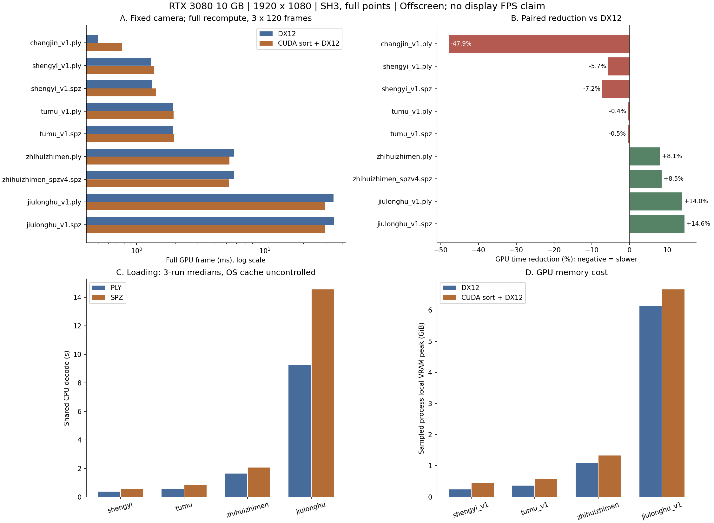

# Windows CUDA 引擎性能分析报告

测试日期：2026-10-27。模型目录：`C:\Users\21544\Desktop\zhishan`，包括其spz子目录。按用户要求，在完成全量实用对比后停止后续复杂长测。

## 结论

**当前CUDA路径适合继续作为大模型的可选加速方案，暂不适合全面替代DX12。** 42个文件中，30个GPU耗时降低、12个回退。391万点PLY约降低8.1%；2248万点PLY/SPZ约降低14.0%/14.6%；80万点约慢6%–7%；17万点约慢48%；125万点基本持平。文件数包含同一场景的不同格式，不能当作42个独立场景的统计样本。

**SPZ明显节省存储，但本机解码通常比PLY慢，加载后渲染速度也没有按压缩率成倍提高。** 最大模型PLY解码约9.24秒、SPZ约14.56秒，两者均为2248万个点。

本次CUDA指“CUDA/CUB排序＋原有DX12投影与绘制”的混合实验路径。以下为离屏完整GPU帧耗时，**不等于WinUI实际显示FPS或输入延迟**。

## 1. 仓库核对与测试范围

已阅读总体技术计划、系统设计、model-io/render-core/engine SDK契约，以及Windows引擎、渲染核心和CudaOperators的相关实现。仓库另有Android Vulkan、Web WebGPU/WGSL和Linux云端CUDA实现，本报告只测试Windows本地路径，不混入云端合成器、网络或图片缓存指标。

默认DX12路径使用HLSL投影/SH、FidelityFX Parallel Sort稳定排序、DX12 quad绘制。CUDA候选保留相同投影与绘制，用CUDA CUB稳定32位key/value排序替换排序，并通过共享资源和fence/semaphore交接。两后端均为三帧槽，分别为 `d3d12-queued`、`cuda-sort-queued`，避免把通用调度优化算成CUDA收益。

CUDA目前仍是独立实验host，构建开关默认OFF，尚未接入产品IEngine/WinUI。其他CUDA投影、组合、tile、compaction与Graph变体不属于本次全量矩阵；历史取舍见[实验总报告](../CudaOperators/EXPERIMENT-REPORT.md)与[第二轮研究](../CudaOperators/RESEARCH-ROUND-2.md)。本次没有修改产品引擎或源模型。

## 2. 测试条件

| 项目 | 配置 |
|---|---|
| GPU/驱动 | RTX3080 10GB，WDDM，617.42 |
| CPU/内存 | Ryzen7 5700G，8核16线程，32GB |
| 系统 | Windows11专业工作站版，10.0.26200 |
| 构建 | 本次重新构建Release x64；VS2026；CUDA13.3，nvcc13.3.33，SM86 |
| 电源 | 卓越性能；未锁定GPU时钟或关闭用户其他程序 |
| 源提交 | ea005561252df0b66e44c1da7ecf1051701d0f6a |
| 输入 | 23个PLY、19个SPZ；17个SPZv3、2个SPZv4；全部解码为SH3 |
| 规模 | 170,799–22,480,361个高斯点 |
| 画质 | 1920×1080物理像素；完整点数与SH3；径向32位稳定排序；stddev=3、alpha阈值0、blur=0、最大半径1024；无LoD、无自动降阶或抽样 |
| 相机 | 各模型fit后统一yaw30°、pitch−45°、dolly2；未使用源目录viewer.json |

加载逐文件执行3轮，共126次，报告中位值。两路径共用CPU model-io，计时包含读取、隔离helper解码、规范化与校验，**不包含GPU上传、CUDA初始化或首帧可见时间**。输入先做SHA-256，未清理系统缓存，因此是偏暖且缓存未受控的本地加载数据，不能视为冷盘测试。

GPU短测为42文件×2后端×3轮，共252次运行、30,240个采样帧；每次60帧预热、120帧采样，AB/BA顺序交替。完整GPU时间由同一D3D12 timestamp时间域测量，包含跨API依赖/交接。各耗时列取3轮中位值；“耗时降低”是3个配对轮次百分比的平均，可能与两列中位值直接相除略有不同。

固定相机仍强制重算投影/排序，用于同工作量对比；产品静止相机可复用排序或进入空闲，不能套用本表。短测尤其小模型会受时钟及后台活动影响，结果用于实用趋势判断，不作为正式产品准入证据。

## 3. 不同规模与格式的代表结果

正值表示CUDA更快，负值表示CUDA更慢。

| 模型 | 高斯点数 | 文件MiB | CPU解码s | DX12 GPU ms | CUDA GPU ms | CUDA耗时降低 |
|---|---|---|---|---|---|---|
| changjin_v1.ply | 170,799 | 38.44 | 0.091 | 0.4997 | 0.7726 | -47.88% |
| shengyi_v1.ply | 804,758 | 181.13 | 0.358 | 1.2974 | 1.3696 | -5.70% |
| spz/shengyi_v1.spz | 804,758 | 17.10 | 0.556 | 1.3169 | 1.4141 | -7.18% |
| tumu_v1.ply | 1,248,730 | 281.05 | 0.537 | 1.9354 | 1.9451 | -0.39% |
| spz/tumu_v1.spz | 1,248,730 | 23.28 | 0.813 | 1.9354 | 1.9497 | -0.46% |
| zhihuizhimen.ply | 3,914,609 | 881.05 | 1.625 | 5.7677 | 5.2931 | +8.12% |
| spz/zhihuizhimen_spzv4.spz | 3,904,214 | 91.77 | 2.056 | 5.7610 | 5.2695 | +8.52% |
| jiulonghu_v1.ply | 22,480,361 | 5059.59 | 9.243 | 34.3404 | 29.4692 | +13.99% |
| spz/jiulonghu_v1.spz | 22,480,361 | 477.56 | 14.559 | 34.4489 | 29.4093 | +14.56% |

小任务无法摊薄跨API同步与提交成本。百万点附近的不到1%变化可视为接近持平；约391万点和2248万点出现较明确收益。但不能据此确定通用的点数切换阈值：可见比例、overdraw、投影大小和相机位置都会改变排序占比。

### 动态相机补充

停止扩展测试前，4个文件各完成一轮“预热30秒＋采样60秒”的动态配对。相机按墙钟连续旋转。以下仅为**单轮补充**，不是三轮正式结果。

| 模型 | DX12 GPU ms | CUDA GPU ms | 耗时降低 |
|---|---|---|---|
| shengyi_v1.ply | 1.2984 | 1.3650 | -5.13% |
| spz/shengyi_v1.spz | 1.3210 | 1.3865 | -4.96% |
| jiulonghu_v1.ply | 34.5364 | 29.6059 | +14.28% |
| spz/jiulonghu_v1.spz | 34.4975 | 29.5875 | +14.23% |

动态组保留9次完成运行，第2轮仅一条未配对CUDA结果，不计入上表。其余在途测试按用户要求停止，不记作引擎故障。目录名中的formal不表示整个正式方案已完成。

## 4. PLY与SPZ加载分析

| 场景 | PLY/SPZ MiB | PLY/SPZ解码s | 体积缩小倍数 | SPZ/PLY解码耗时比 |
|---|---|---|---|---|
| jiulonghu_v1.ply | 5059.59/477.56 | 9.243/14.559 | 10.59× | 1.58× |
| shengyi_v1.ply | 181.13/17.10 | 0.358/0.556 | 10.59× | 1.55× |
| tumu_v1.ply | 281.05/23.28 | 0.537/0.813 | 12.07× | 1.51× |
| zhihuizhimen.ply | 881.05/91.77 | 1.625/2.056 | 9.60× | 1.26× |

SPZ文件约小9–12倍，但需要CPU解压和属性还原；当前CUDA路径没有CUDA解码器。进入统一SplatScene后，渲染主要取决于点数、SH与投影工作量，而非磁盘字节数。

**两份SPZv4与对应PLY的点数不同：** danganguan_v1.ply为1,888,950点，danganguan_spzv4.spz为1,859,737点；zhihuizhimen.ply为3,914,609点，zhihuizhimen_spzv4.spz为3,904,214点。它们的跨格式差异混有内容规模变化，不能作为纯编码格式消融。其余配对即使点数相同，SPZ量化也不保证属性或画面完全相同。CUDA/DX12收益始终在同一个文件内比较。

本机本地查看时，PLY倾向于以更大文件换取更快解码；SPZ适合节省磁盘和传输体积。网络传输、冷盘及完整首帧等待时间没有测试。

## 5. 收益来源与显存代价

| PLY场景 | 投影 DX12/CUDA ms | 排序 DX12/CUDA含交接 ms | 绘制 DX12/CUDA ms | 本地显存峰值 DX12/CUDA GiB |
|---|---|---|---|---|
| changjin_v1.ply | 0.0963/0.0983 | 0.1249/0.3604 | 0.2785/0.3113 | 0.068/0.259 |
| shengyi_v1.ply | 0.3799/0.3901 | 0.3348/0.4060 | 0.5827/0.5724 | 0.241/0.441 |
| tumu_v1.ply | 0.5765/0.5929 | 0.4751/0.4736 | 0.8796/0.8765 | 0.362/0.568 |
| zhihuizhimen.ply | 1.7684/1.8186 | 1.2902/0.7511 | 2.6982/2.6972 | 1.087/1.333 |
| jiulonghu_v1.ply | 10.3726/10.8012 | 7.8321/2.6819 | 15.9662/15.9846 | 6.141/6.666 |

CUDA列的投影和绘制仍由DX12执行；排序列包含CUB与交接。分段分别取中位数，不要求之和严格等于完整帧中位数。

最大PLY排序阶段约7.85→2.68ms，但投影与绘制仍占整帧多数，所以完整帧仅改善约14%。小场景多出的producer/consumer提交、状态转换、跨API同步则导致回退。不能把约3倍的排序速度当作3倍整帧渲染速度。

最大模型进程本地显存约6.14→6.67GiB，额外约0.53GiB。显存为DXGI进程资源节点与约1秒周期采样峰值，不是整机nvidia-smi用量，也可能漏掉短瞬态。全部测试保持完整点数与SH，未降质换速度。

## 6. 正确性与建议

CUDA回归测试8/8通过；126次解码与252次全量GPU短测全部成功。42个文件、3轮固定相机CUDA/DX12图像均逐字节一致，RGB/alpha SSIM为1、误差为0。它证明与当前DX12画面一致，不代替外部参考renderer画质验收。输入、runtime、DLL、helper、shader均保留SHA-256，全量组结束时运行时哈希未变化。

建议继续保留DX12默认后端，CUDA sort-only用于大模型的显式实验选项研究。小模型和接近持平的百万点模型优先DX12，不宜只按扩展名或点数自动切换。

未验证WinUI真实呈现FPS、输入延迟、首帧、其他GPU、完整产品集成及长时间稳定性。既有文档中的Debug Layer句柄退役、异常fence退出问题，本轮也没有修复。当前结果足以判断规模趋势，尚不构成产品后端验收通过。

## 7. 全部42文件明细

全部SH3。CPU解码为共用路径，GPU为固定俯斜视角完整管线短测。

| 模型 | 高斯点数 | 文件MiB | CPU解码s | DX12 GPU ms | CUDA GPU ms | CUDA耗时降低 |
|---|---|---|---|---|---|---|
| changjin_v1.ply | 170,799 | 38.44 | 0.091 | 0.4997 | 0.7726 | -47.88% |
| zhishan.ply | 455,325 | 102.48 | 0.203 | 0.7721 | 0.9272 | -19.35% |
| zhishan_cleaned.ply | 455,325 | 102.48 | 0.207 | 0.7741 | 0.9262 | -19.47% |
| zhishan_v3.ply | 649,520 | 146.19 | 0.280 | 1.0445 | 1.1679 | -11.56% |
| shengyi_v1.ply | 804,758 | 181.13 | 0.358 | 1.2974 | 1.3696 | -5.70% |
| spz/shengyi_v1.spz | 804,758 | 17.10 | 0.556 | 1.3169 | 1.4141 | -7.18% |
| PML_v1.ply | 851,828 | 191.72 | 0.362 | 1.3609 | 1.4295 | -5.25% |
| spz/yulin_v1.spz | 1,027,833 | 19.96 | 0.690 | 1.5903 | 1.6456 | -3.47% |
| yulin_v1.ply | 1,027,833 | 231.33 | 0.445 | 1.6814 | 1.7367 | -3.00% |
| spz/tumu_v1.spz | 1,248,730 | 23.28 | 0.813 | 1.9354 | 1.9497 | -0.46% |
| tumu_v1.ply | 1,248,730 | 281.05 | 0.537 | 1.9354 | 1.9451 | -0.39% |
| spz/xingxi_v1.spz | 1,307,854 | 25.20 | 0.862 | 2.0357 | 2.0204 | +2.55% |
| xingxi_v1.ply | 1,307,854 | 294.36 | 0.558 | 2.0316 | 2.0188 | +0.59% |
| meiyuan_v2.ply | 1,312,897 | 295.49 | 0.553 | 2.0132 | 2.0101 | +0.19% |
| spz/meiyuan_v2.spz | 1,312,897 | 25.41 | 0.854 | 2.0132 | 2.0444 | -0.94% |
| spz/tiyuguan_v1.spz | 1,419,007 | 26.54 | 0.910 | 2.1791 | 2.1565 | +1.34% |
| tiyuguan_v1.ply | 1,419,007 | 319.37 | 0.608 | 2.1719 | 2.1494 | +0.99% |
| spz/tushuguan_v1.spz | 1,438,782 | 28.11 | 0.946 | 2.2062 | 2.1786 | +1.43% |
| tushuguan_v1.ply | 1,438,782 | 323.82 | 0.621 | 2.1955 | 2.1688 | +1.34% |
| jizhonglou_v2.ply | 1,576,115 | 354.73 | 0.677 | 2.4013 | 2.3383 | +2.76% |
| spz/jizhonglou_v2.spz | 1,576,115 | 32.66 | 1.092 | 2.4049 | 2.3388 | +2.67% |
| spz/wenke_v2.spz | 1,757,157 | 35.71 | 1.161 | 2.6737 | 2.5748 | +3.99% |
| wenke_v2.ply | 1,757,157 | 395.48 | 0.751 | 2.6655 | 2.5728 | +3.51% |
| haiwai_v1.ply | 1,838,109 | 413.70 | 0.758 | 2.7853 | 2.6660 | +3.90% |
| spz/haiwai_v1.spz | 1,838,109 | 34.81 | 1.201 | 2.7924 | 2.6798 | +4.07% |
| spz/danganguan_spzv4.spz | 1,859,737 | 32.14 | 0.944 | 2.8273 | 2.7110 | +4.05% |
| danganguan_v1.ply | 1,888,950 | 425.14 | 0.788 | 2.8590 | 2.7361 | +4.32% |
| spz/danganguan_v1.spz | 1,888,950 | 33.61 | 1.235 | 2.8672 | 2.7453 | +4.20% |
| citang_v1.ply | 2,116,317 | 476.31 | 0.876 | 3.1744 | 3.0060 | +5.22% |
| spz/citang_v1.spz | 2,116,317 | 40.48 | 1.398 | 3.1795 | 3.0126 | +5.31% |
| jiaoxuelou_v2.ply | 2,233,426 | 502.67 | 0.972 | 3.3475 | 3.1642 | +5.52% |
| spz/jiaoxuelou_v2.spz | 2,233,426 | 43.38 | 1.498 | 3.3526 | 3.1734 | +5.41% |
| J1_v3.ply | 2,625,008 | 590.80 | 1.104 | 3.8927 | 3.6429 | +6.46% |
| spz/J1_v3.spz | 2,625,008 | 47.30 | 1.720 | 3.8886 | 3.6582 | +5.94% |
| juyuan_v2.ply | 2,670,017 | 600.93 | 1.103 | 3.9603 | 3.7079 | +6.49% |
| spz/juyuan_v2.spz | 2,670,017 | 50.17 | 1.726 | 3.9619 | 3.7064 | +6.42% |
| he_v1.ply | 2,973,002 | 669.13 | 1.246 | 4.3935 | 4.0842 | +6.99% |
| spz/he_v1.spz | 2,973,002 | 48.70 | 1.926 | 4.3955 | 4.0924 | +8.46% |
| spz/zhihuizhimen_spzv4.spz | 3,904,214 | 91.77 | 2.056 | 5.7610 | 5.2695 | +8.52% |
| zhihuizhimen.ply | 3,914,609 | 881.05 | 1.625 | 5.7677 | 5.2931 | +8.12% |
| jiulonghu_v1.ply | 22,480,361 | 5059.59 | 9.243 | 34.3404 | 29.4692 | +13.99% |
| spz/jiulonghu_v1.spz | 22,480,361 | 477.56 | 14.559 | 34.4489 | 29.4093 | +14.56% |

## 8. 原始数据

证据根目录：[2026-10-27-performance-review](../CudaOperators/evidence/2026-10-27-performance-review/README.md)。

- [全部性能/分段/内存CSV](../CudaOperators/evidence/2026-10-27-performance-review/model-summary.csv)、[逐轮加载CSV](../CudaOperators/evidence/2026-10-27-performance-review/loading.csv)、[格式配对CSV](../CudaOperators/evidence/2026-10-27-performance-review/format-pairs.csv)。
- [输入指纹](../CudaOperators/evidence/2026-10-27-performance-review/inputs.json)、[环境](../CudaOperators/evidence/2026-10-27-performance-review/environment.json)、[验证计数](../CudaOperators/evidence/2026-10-27-performance-review/verification.json)、[42模型截图](../CudaOperators/evidence/2026-10-27-performance-review/all-models-contact-sheet.jpg)。
- all-models-static目录保留全部252次逐帧计时、内存CSV、PNG和日志，以及精确命令和runtime指纹。representative-orbit-formal是按用户要求中止的扩展组，不与全量三轮短测混算。
- run.py为采集脚本，summarize.py验证/汇总/作图，write_report.py生成本报告。重新采集须使用新目录，不覆盖本次证据。
